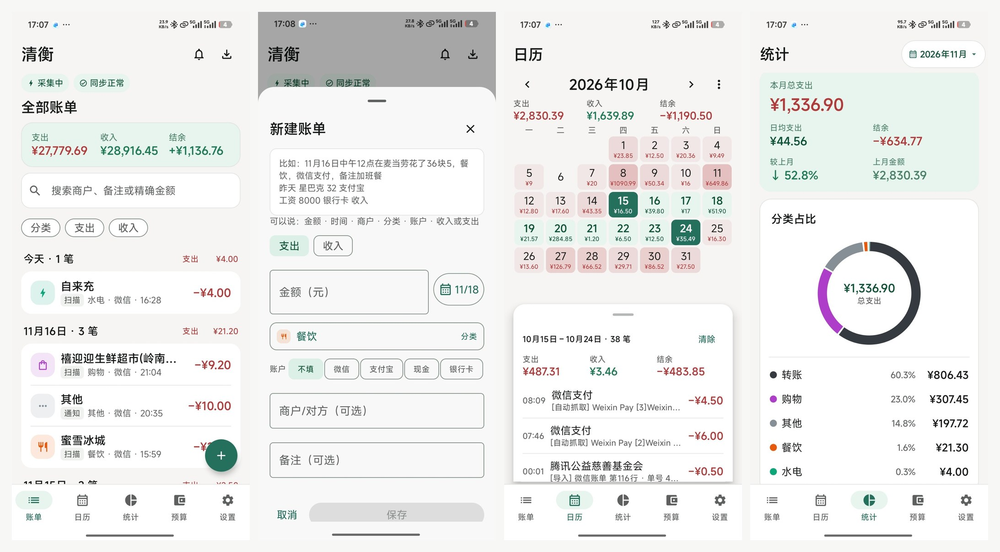
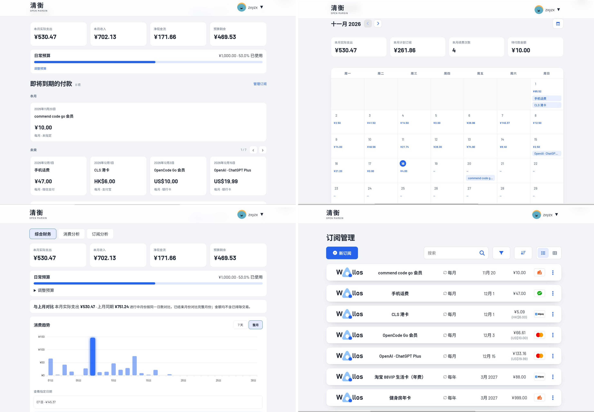
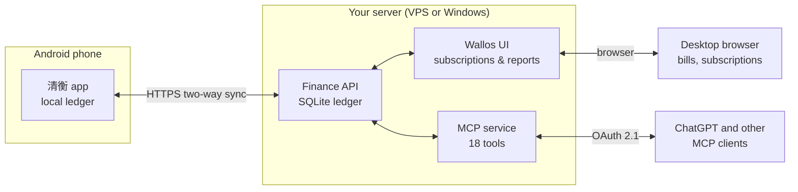

# 清衡 · Open Margin

[中文](README.md) · [English](README.en.md)

Self-hosted bookkeeping with MCP. Transactions record themselves, and the ledger lives on your own devices — you keep both the privacy and the keys.

The screenshots below show capture and bookkeeping on mobile, plus desktop views for the overview, calendar, statistics and subscription management.

<p align="center">
  
</p>

<p align="center">
  
</p>

> **Status: pre-release, single-owner deployment.** Real WeChat/Alipay notification coverage depends on the phone and ROM. Captured notifications are not bank statements — check important spending against official records. No banking credentials, and nothing is paid on your behalf.

## Capture, then fill the gaps

WeChat, Alipay and bank payment notifications and SMS become records. Where notifications don't reach, accessibility reading and screenshot OCR fill in.

Android restricts reading other apps' billing data. Full capture needs ROOT or a system patch, which 清衡 does not use. Transactions that slip past capture can be imported from WeChat or Alipay statements:

- Import CSV / XLSX with a preview before anything is written
- Match against captured records by time, amount and merchant to avoid duplicates
- Unmatched rows go to a reconciliation queue for you to confirm one by one

Capture prefers a question over a silent loss:

| Case | Handling |
|---|---|
| Same source, merchant, direction, currency, amount within 8s | Treated as a confident duplicate, skipped |
| Same amount, direction, currency within 3 min | Saved and flagged as a possible duplicate; you keep or delete it |
| Records that already exist | Never deleted automatically |

## One line per record

```
lunch 25 WeChat
yesterday Starbucks 32 Alipay
salary 8000 bank card income
```

Amount, category, account, date and direction parse out on their own. You can also record by voice — recognition runs on the phone. Amounts are stored as integer cents; fields that can't be parsed stay empty and flagged rather than guessed.

## MCP: an AI that reads and manages the ledger

清衡 exposes 18 MCP tools — 8 read, 10 write. Once connected and authorized, an AI can query spending, add records, change categories, set budgets, manage subscriptions and work the reconciliation queue.

| Read | Write |
|---|---|
| `list_recent_transactions` | `add_record` |
| `spending_summary` | `edit_record` |
| `personal_finance_long_term_trends` | `exclude_record` |
| `get_subscription_list` | `delete_record` |
| `get_recurring_expense_candidates` | `register_merchant_rule` |
| `get_monthly_budget` | `link_refund` |
| `finance_reconciliation_queue` | `add_subscription` |
| `finance_duplicate_review` | `edit_subscription` |
| | `delete_subscription` |
| | `set_monthly_budget` |

Auth uses OAuth 2.1 dynamic client registration with S256 PKCE and scopes; a client that requests no scope is read-only. The ledger stays yours, and the AI works through the same data and permissions. Grant access only to clients you trust.

## Data ownership

The ledger lives on your phone and your own server, reachable from both. Adds, edits and deletions sync both ways; when both sides change the same record, you pick which version to keep, one at a time. Nothing passes through the developer's servers.

## Subscriptions

Track name, amount, cycle and next charge date, set reminders, and see monthly average and annual cost. Subscriptions stay separate from daily spending — **an expected charge is never counted as money already paid**.

## Also included

Calendar range totals, category breakdown, seven-day trend, monthly budget, record splitting, refund linking, merchant rules, CSV export. Currencies summarize independently with no implied FX conversion.

## Sync architecture



**On a VPS**, the server stays up, so the phone syncs from any network.

**On Windows**, the service and the ledger run on your own machine and the phone syncs over Tailscale Funnel — no domain needed, and the phone does not install Tailscale. With the PC off, the phone keeps recording and catches up later. WorkManager retries at a 15-minute minimum under Android's battery rules.

## Install

**VPS** — follow the [deployment guide](docs/DEPLOY_VPS.md) to configure the server and domain, then connect the phone to your ledger.

**Windows** — download `OpenMargin-Setup.exe` and follow the installer wizard. The build is unsigned; verify the SHA256 published on the Release page first. See [Windows deployment](docs/DEPLOY_WINDOWS.md).

**Android** — install the APK from the [download page](https://zxyzx.me/open-margin/installer/). Android 7.0 and up.

## Backup

Back up both databases separately: Wallos **subscriptions** and Finance **transactions**.

```sh
docker compose --profile maintenance run --rm backup
```

Snapshots carry integrity checks, atomic writes and 30-day retention. Schedule it daily with your host's scheduler. Same-host backups don't survive a disk or provider failure — keep **encrypted off-site copies** as well.

Never delete or reset the live SQLite database to fix a problem. Keep immutable snapshots and verify a restore against a copy before relying on it.

## Security notes

- Services listen on `127.0.0.1` only. Do not expose 8767 or 18082 to the internet.
- Restrict access to a fresh instance until you register the first account, or whoever arrives first becomes the ledger owner.
- `secrets/` is mode 0700 and `secrets/backend.env` is 0600, both gitignored. If a device token leaks, rotate it and reconfigure the phone.
- This is a **single-owner** design. The daily ledger, OAuth and MCP are all bound to the configured owner ID; multi-tenant isolation is not implemented.

## Known limitations

- An old on-device ledger cannot be imported into a new installation. **Back up unsynced transactions before uninstalling** an older APK.
- Notification formats vary by channel; transfers, split payments and refunds may be missed.
- The Wallos `header.php` and `index.php` overlays are pinned to one upstream release — rebase and review them before upgrading the upstream image.
- No bundled cloud TLS, off-site backup, payment gateway or live bank reconciliation.
- Unattended capture is not guaranteed on every Chinese OEM ROM.

## Tests

```sh
python3 -m pip install -r backend/requirements.txt "httpx>=0.27,<1"
cd backend && FINANCE_PUBLIC_URL=https://finance.example.com/finance python3 -m unittest discover -p "test_*.py" -v
cd .. && python3 scripts/check-public-ready.py
```

`scripts/smoke_clean_install.py` is a clean-room integration script. It needs a throwaway empty stack bound to ports 18767 and 18083 and writes synthetic data. **Never run it against live data.** The full acceptance run is in [docs/ACCEPTANCE.md](docs/ACCEPTANCE.md).

## License

The root GPL-3.0 license covers the Wallos-derived distribution. The Android app is a derivative of [Seamless Bookkeeping](https://github.com/DykiSensei/seamless-bookkeeping) (MIT) and keeps that license; attribution is in `android/LICENSE`. Subscriptions and reports are based on [Wallos](https://github.com/ellite/Wallos) (GPL-3.0). See `THIRD_PARTY.md` for component details. Copyright in the upstream implementations remains with their authors.
