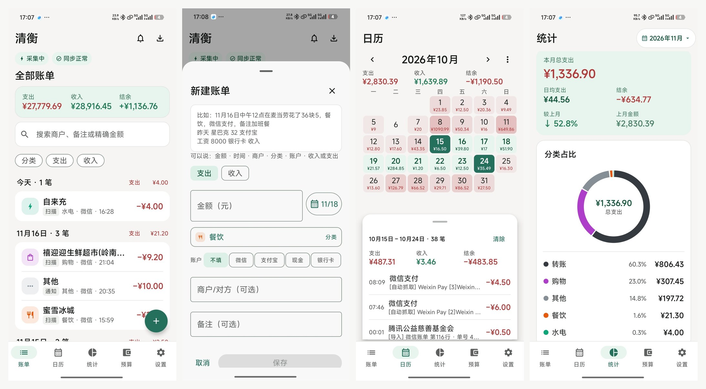
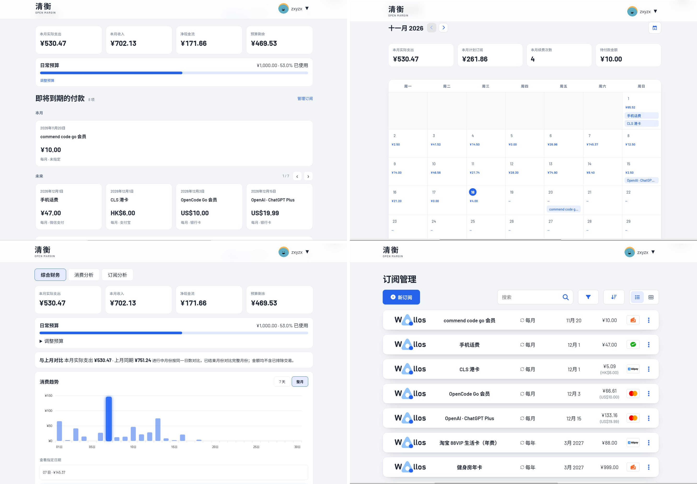
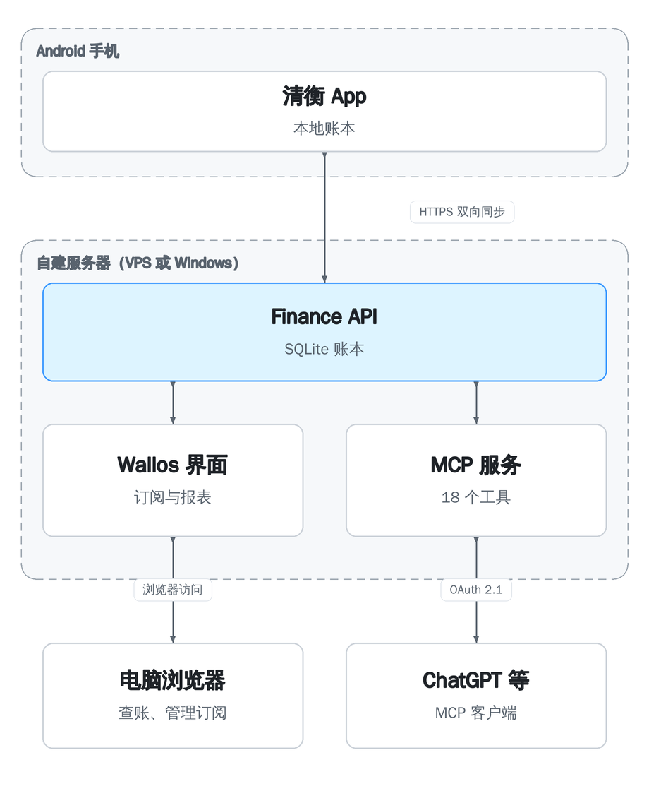

# 清衡 · Open Margin

[中文](README.md) · [English](README.en.md)

支持 MCP 的自托管记账工具。交易自动入账，账本保存在自己的设备中，数据隐私和调用自由由你掌握。

下面的截图展示手机端账单、记账、日历与统计，以及桌面端总览、日历、统计和订阅管理。

<p align="center">
  
</p>

<p align="center">
  
</p>

> **状态：预发布，单用户部署。** 真实微信/支付宝通知的覆盖率取决于手机和 ROM，采集到的通知不能当作银行对账单，重要支出请与官方账单核对。不连接银行凭据，不代替你付款。

## 自动采集与导入补全

微信、支付宝和银行的付款通知、短信可以生成账单；通知覆盖不到的页面，可以用无障碍读屏和截图 OCR 补充。

Android 对读取其他应用账单有系统限制。完整获取需要 ROOT 或系统补丁，清衡暂不采用。未自动记录的交易可以定期导入微信、支付宝账单：

- 导入 CSV / XLSX，入账前先预览
- 与自动记录按时间、金额和商户比对，避免重复
- 无法匹配的记录进入对账队列，逐条确认

采集策略是宁可留疑，不静默丢弃：

| 情况 | 处理 |
|---|---|
| 同来源、商户、方向、币种、金额，8 秒内 | 判为高置信重复，跳过 |
| 同金额、方向、币种，3 分钟内 | 保存并标记「疑似重复」，由你在账单页决定保留还是删除 |
| 已存在的记录 | 永不自动删除 |

## 一句话记账

```
午饭 25 微信
昨天 星巴克 32 支付宝
工资 8000 银行卡 收入
```

金额、分类、账户、日期和收支方向自动解析，不需要逐项填写。也可以用语音记账，识别在手机本地完成。金额一律按整数分存储，解析不出的字段留空并标记，不猜。

## MCP：AI 读取和管理账目

清衡提供 18 个 MCP 工具，8 个只读、10 个写入。连接并授权后，AI 可以查询支出、添加账单、修改分类、设置预算、管理订阅和处理对账。

| 只读 | 写入 |
|---|---|
| `list_recent_transactions` | `add_record` |
| `spending_summary` | `edit_record` |
| `personal_finance_long_term_trends` | `exclude_record` |
| `get_subscription_list` | `delete_record` |
| `get_recurring_expense_candidates` | `register_merchant_rule` |
| `get_monthly_budget` | `link_refund` |
| `finance_reconciliation_queue` | `add_subscription` |
| `finance_duplicate_review` | `edit_subscription` |
| | `delete_subscription` |
| | `set_monthly_budget` |

鉴权使用 OAuth 2.1 动态客户端注册 + S256 PKCE 和作用域，未申请作用域的客户端只能读。账本仍由你管理，AI 的操作使用同一套数据和权限。只把访问权授予你信任的客户端。

## 数据主权

账本保存在手机和你自己的服务器，手机、电脑都能访问。新增、修改和删除双向同步；两端同时修改同一笔时，逐条选择保留哪一版。数据不经过清衡开发者的服务器。

## 订阅管理

记录订阅名称、金额、周期和下次扣款日，设置到期提醒，并查看月均和年度支出。订阅账目与日常消费分开管理——**预估的订阅扣款不会被当成本月已付支出**。

## 其他功能

日历区间统计、分类占比、近七日趋势、月度预算、账单拆分、退款关联、商户规则、CSV 导出。多币种各自独立汇总，不做隐含汇率换算。

## 同步架构

<p align="center">
  
</p>

| 组件 | 跑在哪 | 连到谁 |
|---|---|---|
| 清衡 App（本地账本） | Android 手机 | Finance API，HTTPS 双向同步 |
| Finance API（SQLite 账本） | 你的服务器 | 手机、Wallos、MCP |
| Wallos 界面（订阅与报表） | 你的服务器 | Finance API；你用电脑浏览器访问 |
| MCP 服务（18 个工具） | 你的服务器 | Finance API；ChatGPT 等客户端用 OAuth 2.1 连入 |

手机只跟 API 说话，浏览器只跟 Wallos 说话，AI 只跟 MCP 说话。三者共用同一份账本。

**VPS 部署**：服务器常开，手机在任何网络下都能同步。

**Windows 部署**：服务和账本运行在自己的电脑上，手机通过 Tailscale Funnel 同步，不需要额外域名，手机也不用装 Tailscale。电脑关机期间手机照常记账，联网后补同步。WorkManager 重试间隔最短 15 分钟，受 Android 省电策略限制。

## 手机配对

两种部署共用同一套扫码流程，不区分普通域名和 Tailscale 域名。

**VPS**：账本所有者登录 Wallos 后台 → 头像菜单 →「手机配对」→「生成配对二维码」，手机打开清衡 App → 同步 → 重新配对，直接扫码。

二维码只在你点击后由后端接口临时生成，不写进静态页面、日志或浏览器缓存；页面 5 分钟后自动隐藏，刷新即失效。只有账本所有者能生成，普通账号看不到入口。

**Windows**：安装向导最后一步会显示同一个格式的二维码，手机用同一台扫码页扫描。

二维码里是**长期有效的设备密钥**：隐藏不等于过期，别截图外发。真泄露了需要在服务器轮换 `FINANCE_DEVICE_TOKEN` 并重新配对，这会断开已连接的手机。

## 安装

**VPS**：按 [部署文档](docs/DEPLOY_VPS.md) 配置服务器和域名，再把手机连接到你的账本。

**Windows**：下载 `OpenMargin-Setup.exe`，运行安装向导，按步骤完成配置。安装包未签名，请先核对 Release 页公布的 SHA256，详见 [Windows 部署](docs/DEPLOY_WINDOWS.md)。

**Android**：从[下载页](https://zxyzx.me/open-margin/installer/)安装 APK，支持 Android 7.0 及以上版本。

## 备份

两份数据库需要分别备份：Wallos 的**订阅**和 Finance 的**交易**。

```sh
docker compose --profile maintenance run --rm backup
```

快照带完整性校验、原子写入和 30 天保留，用宿主机的计划任务每天跑一次。同机备份经不起磁盘或服务商故障，请另外维护**加密的异地备份**。

不要为了修问题去删除或重置线上 SQLite 数据库。保留不可变快照，恢复前先在副本上验证。

## 安全须知

- 服务默认只监听 `127.0.0.1`，不要把 8767 或 18082 直接暴露到公网。
- 全新实例在注册第一个账号前要限制访问来源，否则先到的人会成为账本所有者。
- `secrets/` 权限 0700，`secrets/backend.env` 0600，两者都在 `.gitignore` 内。设备令牌泄露要立刻更换并重配手机。
- 这是**单用户**设计。每日账本、OAuth 和 MCP 都限定在配置的所有者 ID 上，多租户隔离没有实现。

## 已知限制

- 旧版手机上的账本不能自动导入新安装，**卸载旧 APK 前先备份未同步的交易**。
- 支付通知格式因渠道而异，转账、拆分支付和退款可能漏记。
- Wallos 的 `header.php` 和 `index.php` 覆盖层基于固定的上游版本，升级上游镜像前需要重新比对。
- 不内置云 TLS、异地备份、支付通道对接和实时银行对账。
- 无法保证在所有国产 ROM 上无人值守采集。

## 测试

```sh
python3 -m pip install -r backend/requirements.txt "httpx>=0.27,<1"
cd backend && FINANCE_PUBLIC_URL=https://finance.example.com/finance python3 -m unittest discover -p "test_*.py" -v
cd .. && python3 scripts/check-public-ready.py
```

`scripts/smoke_clean_install.py` 是空环境集成脚本，需要一套绑定 18767 和 18083 端口的临时空栈，会写入合成数据。**不要对着线上数据跑。** 完整验收流程见 [docs/ACCEPTANCE.md](docs/ACCEPTANCE.md)。

## 许可

根目录 GPL-3.0 覆盖 Wallos 衍生的分发部分。Android 部分是 [Seamless Bookkeeping](https://github.com/DykiSensei/seamless-bookkeeping)（MIT）的衍生作品，保留原有 MIT 许可，署名见 `android/LICENSE`；订阅与报表基于 [Wallos](https://github.com/ellite/Wallos)（GPL-3.0）。第三方组件细节见 `THIRD_PARTY.md`，上游实现的著作权归原作者。
